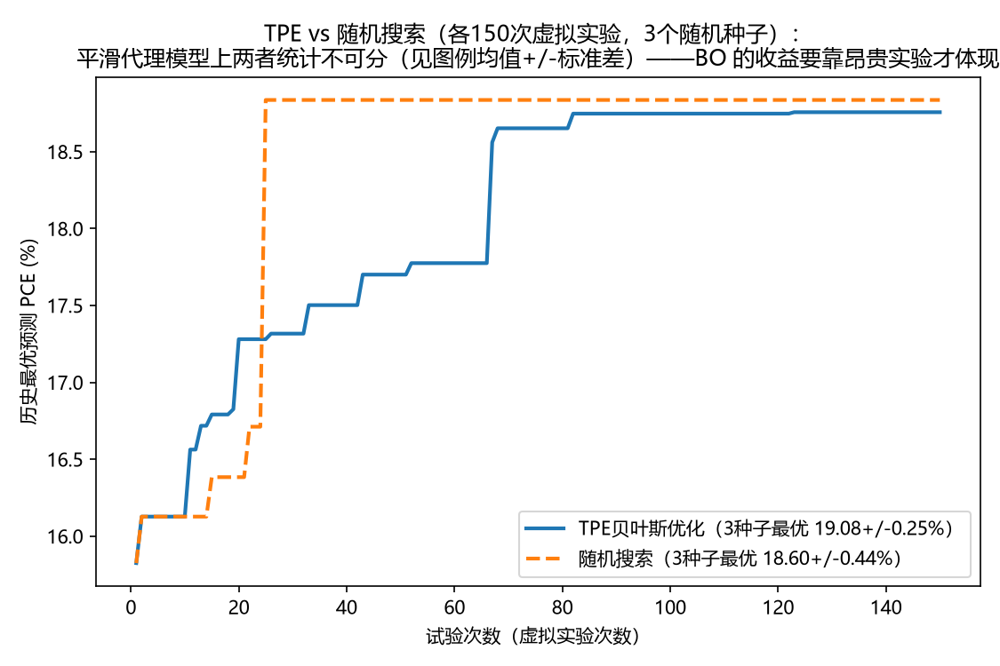

# 项目12：贝叶斯优化自动寻优工艺窗口（self-driving lab 入门）

用项目 9 的随机森林（工艺→PCE，R²=0.657）作为**虚拟实验室**，
在真实工艺参数范围内跑 Optuna TPE 贝叶斯优化，并与随机搜索对比。
**不需要任何新数据**——数据复用项目 9 下载的 Perovskite Database（4.2 万器件）。

## 为什么这是 self-driving lab 的正确入门姿势

Self-driving lab 的核心循环 = 提议实验 → 做实验 → 更新模型 → 再提议。
真实实验室里"做实验"最贵，所以入门先把它替换成代理模型（虚拟实验室），
专门练**搜索策略**这一环：同样的实验预算，聪明的搜索能不能找到更好的窗口。

## 搜索空间设计（三个防钻空子的设计，组会亮点）

1. **淬灭介质只在真实类别中搜**（氯苯/甲苯/乙醚），排除 "Unknown/other"
   ——项目 9 已证明 Unknown 是数据质量混杂因子（重要性第一名的教训）
2. **带隙按组分锁定**（训练集中位数）——带隙由组分决定，不允许独立乱搜
3. **测试条件固定典型值**（0.1 cm²、Air、2025 年、旋涂、nip）
   ——不给模型"调测试条件刷分"的自由度

搜索维度：退火温度 80–150 ℃、退火时间 5–120 min、厚度 150–800 nm、
湿度 0–60%、淬灭介质×3、组分×3、ETL×5、HTL×5、背电极×3（共 9 维混合空间）。

## 结果（各 150 次虚拟实验 × 3 个随机种子）

| 策略 | 最优预测 PCE（3 种子均值 ± 标准差） |
|---|---|
| TPE 贝叶斯优化 | **18.76 / 19.36 / 19.11 → 19.08 ± 0.25%** |
| 随机搜索 | 18.84 / 17.98 / 18.97 → 18.60 ± 0.44% |

最优窗口：退火 135 ℃ / 10 min、厚度 650 nm、组分 FAMAPbBrI、淬灭 Diethyl ether、ETL=PCBM-60 | BCP、HTL=PTAA、背电极 Ag（预测 18.76%）。
支撑度检查：最优解邻域有 29 个真实训练样本——不是钻数据空隙。
随机搜索 3 个种子的结果完全一致（它不依赖模型预测），TPE 则对代理模型的
数值噪声敏感——脚本里把随机森林预测固定为单线程（`n_jobs=1`）才可复现，
这个坑本身就是收获。

## 两个诚实的发现

1. **平滑代理模型上 BO 优势有限**：多种子均值差约 0.5%，且单种子对比
   可能反转（我们观察到 TPE 单种子均值在两次实验间波动近 1%）。BO 的
   收益来自**昂贵实验**——代理模型便宜时差距会被"多跑一次"抹平，这是
   self-driving lab 立项要算的账。
2. **湿度的"高重要性"是稀疏覆盖的假象**：该字段只覆盖 2.5% 的样本
   （其余被中位数插补成 30%）。固定其它参数直接扫描湿度 0→90%，
   预测 PCE 完全平坦（18.86% 纹丝不动）——单变量效应为零，fANOVA 的
   高重要性来自稀疏插补结构与交互项，而非真实物理。**对每个"重要"
   特征做单变量扫描，一眼识破**——这个诊断动作比结论本身更值钱。

## 文件

| 文件 | 内容 |
|---|---|
| `virtual_lab_optuna.py` | 全流程脚本（# %% 格式）：清洗→RF→搜索→出图 |
| `fig1_optimization_trace.png` | TPE vs 随机搜索收敛曲线 |
| `fig2_param_importance.png` | fANOVA 参数重要性 |
| `fig3_best_window.png` | 最优解在退火平面上的位置（叠训练数据分布） |
| `best_params.json` | 最优工艺窗口 |

## 环境

Python 3.14，optuna 5.0（pip 直连），sklearn/pandas/matplotlib，
数据路径指向 `p9_database/data/`。全程 CPU 约 3 分钟。
