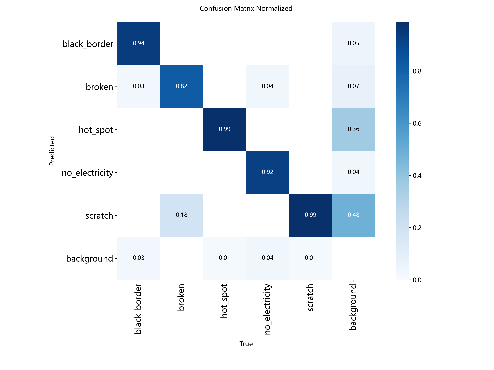

# 项目13：光伏组件缺陷视觉检测（YOLOv8，开源数据版）

用 YOLOv8 做光伏组件多缺陷自动检测——"拍图→自动分类计数"的最小可运行版本。
数据全部来自 HuggingFace 直接下载（走 hf-mirror），**无需任何邮件申请或账号**。

## 数据

**PV_Multi_Defect-corrected**（KeenForge 整理版，HF DOI 10.57967/hf/10882）
——PV-Multi-Defect 数据集的清理、划分与 YOLO 规整版：

- 1,044 张光伏组件图（723 训练 / 155 验证 / 166 测试），3,403 个标注框
- 5 类缺陷：black_border（黑边）、broken（破损）、hot_spot（热斑）、
  no_electricity（断路/不发光）、scratch（划痕）
- 下载方式：`HF_ENDPOINT=https://hf-mirror.com` + `huggingface_hub.snapshot_download`
  （见 `train_yolo.py` 顶部说明），已存 `data/PV_Multi_Defect/`

## 结果（yolov8n，COCO 预训练迁移，15 epochs @640，CPU 约 1.5 小时）

| 指标 | 值 |
|---|---|
| mAP50 | **0.762** |
| mAP50-95 | 0.471 |
| Precision / Recall | 0.719 / 0.661 |

逐类 mAP50-95：no_electricity 0.72 > hot_spot 0.49 ≈ broken 0.46 ≈
black_border 0.45 > scratch 0.24。



混淆矩阵对角线
0.94 / 0.82 / 0.99 / 0.92 / 0.99——分类本身几乎不出错；
主要扣分在**框的定位精度**（mAP50-95），尤其是 scratch：细长目标
对 IoU 阈值敏感，且 18% 的 broken 被误判为 scratch（视觉形态相近）。

## 文件

| 文件 | 内容 |
|---|---|
| `train_yolo.py` | 数据校验 → 训练 → 验证 → 推理，# %% 单元格格式 |
| `confusion_matrix*.png` | 验证集混淆矩阵 |
| `training_curve.png` | 损失与 mAP 训练曲线 |
| `test_preds/`（运行后生成） | 测试图推理可视化（框+置信度） |
| `runs/pv_defect_yolov8n/weights/best.pt` | 训练好的模型权重 |

## 批判性说明（组会用）

- **类别不均衡**：broken 训练集仅 69 框（hot_spot 有 1,087），是 broken
  定位指标偏差的原因之一；改进方向：过采样/复制粘贴增广/加权损失。
- **数据域与项目的差异**：开源可得的缺陷图是组件级红外/EL 图；
  项目原设想（针孔、晶界、指状缺陷）需要钙钛矿薄膜显微图——
  开源没有现成带框数据集，这正是"自己标 50-100 张"的切入点。
  本项目的流水线（YOLO 格式标注 → 训练 → mAP → 部署）完全可迁移：
  拍图后用 labelimg 按 YOLO 格式标注即可换数据重训。

## 数据下载

```bash
python download_data.py   # 走 hf-mirror，约 60MB / 4184 个文件，无需账号
```

## 环境

Python 3.14，ultralytics 8.4（pip 直连），torch CPU。
yolov8n.pt 预训练权重从 hf-mirror 下载（GitHub Releases 被墙）。
