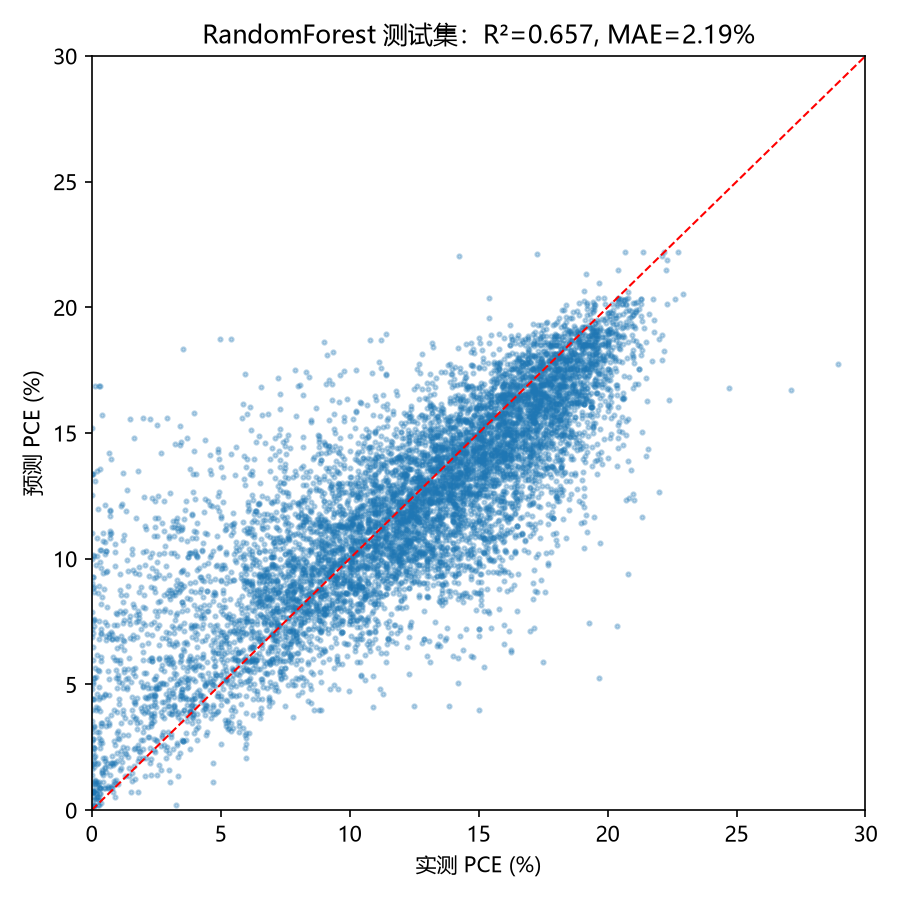
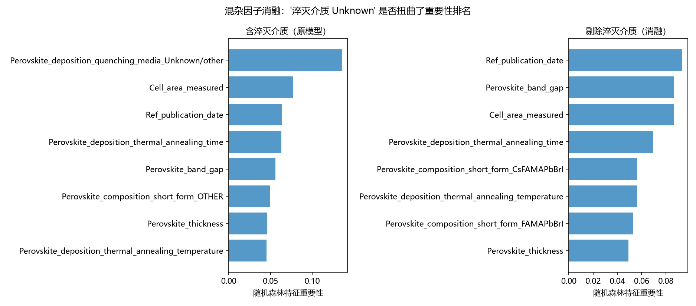

# 项目9：钙钛矿工艺参数 → 效率 回归建模（开源数据版）

基于 **The Perovskite Database Project**（Jacobsson et al., *Nat. Energy* 2021,
CC-BY 4.0）——42,443 个钙钛矿器件记录 × 410 列全流程工艺参数与性能数据。

- 数据来源：[GitHub Jesperkemist/perovskitedatabase_data](https://github.com/Jesperkemist/perovskitedatabase_data)
  （Zenodo DOI 10.5281/zenodo.5834698），本仓库 `data/perovskite_database_all.csv`（84.7 MB）
- 官网：<https://www.perovskitedatabase.com>

> 本仓库不含数据文件（84.7MB）：运行 `python download_data.py`（断点续传；
> 直连被墙时脚本内附 12 路分段并行下载的备用命令）。

## 任务

用工艺参数回归器件效率 `JV_default_PCE`，回答"哪些工艺变量最影响效率"。
特征覆盖：沉积方式、淬灭介质、退火温度/时间/气氛、合成气氛湿度、钙钛矿组分/厚度/带隙、
ETL/HTL/背电极层结构、器件架构、测试气氛、扫描速度、发表年份。

## 流程（`process_pce_regression.py`，# %% 单元格格式）

1. 列筛选：只加载 22 个相关列（410 列全载太慢）
2. 清洗：排除组件/模块与无效 PCE → 34,458 行；
   多步值（"Spin-coating >> CBD"、"Unknown >> 100.0"）取第一段/最后一个数值；
   高基数类别保留前 10 类 + OTHER
3. 建模：随机森林 vs HistGradientBoosting，80/20 划分 + 5 折交叉验证
4. 产出：模型指标 CSV + 三张图（随仓库分发）

## 结果

| 模型 | R² (test) | MAE (test) | 5 折 CV R² |
|---|---|---|---|
| RandomForest | **0.657** | **2.19%** | 0.634 ± 0.006 |
| HistGradientBoosting | 0.581 | 2.52% | 0.568 ± 0.002 |

| RF（剔除混杂因子） | 0.653 | 2.22% | —— |


效率 Top 影响因素（随机森林重要性）：

1. 淬灭介质是否"Unknown"（0.136）⚠️ 数据质量混杂因子，见下
2. 电池有效面积（0.077）
3. 发表年份（0.063）——领域整体进步的时间趋势
4. 退火时间（0.063）、带隙（0.056）、组分（0.049）、膜厚（0.046）、退火温度（0.045）



## 消融实验：混杂因子确实在扭曲排名

剔除"淬灭介质"特征重训（`fig4_importance_ablation.png`）：R² 仅从 0.657
降到 0.653——模型几乎没有损失真实信号，却摆脱了"记录质量"混杂；
新排名前列全部换成物理变量（发表年份、带隙、面积、退火时间/温度）。



## ⚠️ 两点批判性说明（组会答辩用得上）

- **"Unknown" 淬灭介质的重要性最高是数据质量混杂**：不写淬灭条件的记录
  系统性地来自特定年代/类型的文献，模型学到的是"记录质量"与效率的相关，
  不是物理因果。正确做法是把该特征剔除后重跑（留作练习）。
- **R²≈0.66 不是模型不行**：数据库的工艺记录粒度参差（同为"退火 100 ℃"，
  升温速率/气氛纯度/操作细节差异巨大），且器件间还存在未记录变量。
  文献中同类全数据库回归的 R² 也在 0.6~0.7 量级。

## 与实验室项目的衔接

`sclc_pipeline/samples.csv` 的工艺字段（转速、退火、有无 PCBM）与本脚本
特征一一对应；实验室数据积累足够后，直接替换数据源重跑本脚本
即可得到自己的"工艺→迁移率/PCE"回归。项目 12（贝叶斯优化）的搜索
空间也可以直接用这里的特征重要性来定优先级。

## 预测工具

```bash
python predict_pce.py                    # 贝叶斯优化最优窗口
python predict_pce.py --T 150 --t 10 --thickness 300   # 自定义工艺
```

首次运行自动训练随机森林并缓存（`model_rf.joblib`，不入库），之后秒级响应。
固定测试条件（0.1 cm²、Air、nip、2025 年）以防"调测试条件刷分"。

## 测试

```bash
python -m pytest test_cleaning.py -v
```

## 环境

Python 3.14，pandas / scikit-learn / matplotlib，CPU 数分钟内跑完。
